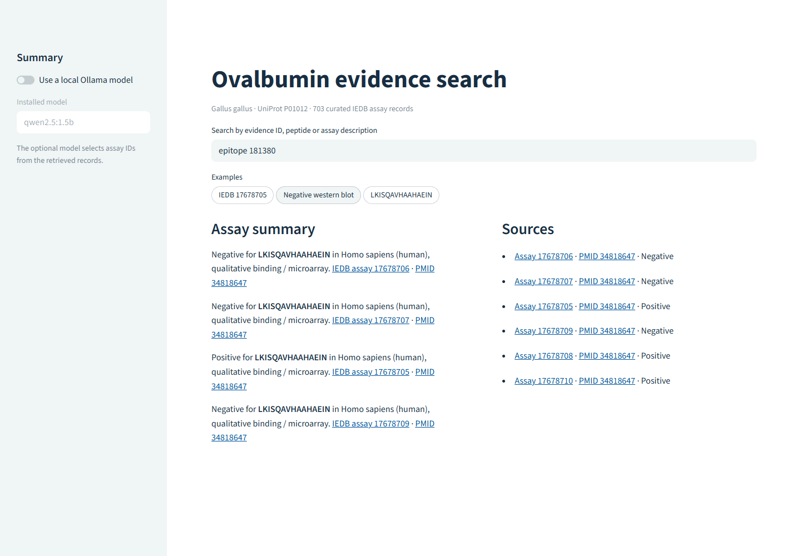

# Ovalbumin evidence search

**Can a scientific search tool retrieve traceable assay records for a question about a reference antigen?**

Search a frozen corpus of chicken ovalbumin assays by IEDB ID, exact peptide or assay terminology. Each claim in the generated summary is tied to an IEDB assay and an indexed PubMed record.

## Results

The frozen index contains **703 assays from three studies**. All seven retrieval and citation checks passed. The [evaluation table](results/evaluation.csv) covers lookup by ID, peptide and text, including intentional no-hit queries.



## Methods

Route identifiers and exact sequences to exact matches. Rank text queries with TF–IDF and study context terms, then diversify frequent studies. The core app renders summaries directly from returned fields. As an optional local AI step, Ollama selects up to four IDs from the hits. IDs outside the retrieved set are rejected and the resulting facts are always rendered from the original records.

## Reproduce

Use Python 3.12 in this repository.

```powershell
python -m venv .venv
.\.venv\Scripts\python -m pip install -r requirements.txt
.\.venv\Scripts\python analysis.py
.\.venv\Scripts\python -m unittest discover -v
```

On macOS and Linux, use `.venv/bin/python` in place of the Windows executable.
The analysis uses the snapshot included in `data/`.

Start the interface with `python -m streamlit run app.py`. Results in the repository are ready to explore after installing the requirements.

Optional local AI setup uses [Ollama](https://ollama.com/) with `ollama pull qwen2.5:1.5b`. Enable the model in the app. The local Qwen integration was tested on a query about epitope 181380. The default search and summaries run offline using the bundled index.

## Interpretation

The corpus contains three ovalbumin studies. Text ranking is lexical. The seven hand-written examples validate basic search behavior on the bundled corpus. For new data, `python refresh.py raw/new-snapshot` writes a snapshot for review.

## Sources and licenses

[IEDB IQ-API](https://query-api.iedb.org/docs/swagger/) · [Europe PMC literature API](https://europepmc.org/RestfulWebService) · [PubMed](https://pubmed.ncbi.nlm.nih.gov/) · [Ollama Qwen2.5 model](https://ollama.com/library/qwen2.5)

Input URLs and hashes are recorded in [data/sources.json](data/sources.json). The MIT license applies to this repository's code. Original datasets, structures and external scores retain their source terms.
